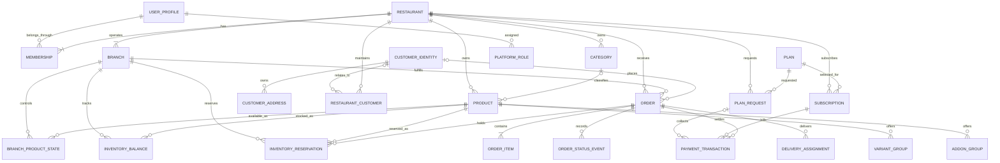

# Modelo de datos multiempresa

**Producto:** plataforma SaaS multiempresa para restaurantes

**Estado:** documento de modelo lógico revisado y aprobado por el propietario el 5 de noviembre de 2026

**Base:** requisitos del producto y arquitectura aprobada
**Alcance:** entidades, relaciones, propiedad y reglas de integridad. Las rutas y colecciones concretas de Firestore se diseñarán en el Día 5.

## 1. Objetivo

Definir un modelo lógico que permita operar muchos restaurantes sobre la misma plataforma, mantener aislados sus datos y relacionar de forma segura usuarios, sedes, catálogos, pedidos, clientes y suscripciones.

Este documento describe conceptos y relaciones, no un esquema físico de Firestore. No determina todavía nombres de colecciones, subcolecciones, índices, reglas o consultas específicas.

## 2. Principios del modelo

1. Toda entidad comercial tendrá un propietario y un alcance explícitos: plataforma, tenant, sede, cliente o pedido.
2. Las entidades pertenecientes a un restaurante se asociarán a un `restaurantId` lógico. Cuando una entidad pertenezca a una sede, también tendrá un `branchId` que corresponda a ese restaurante.
3. Una cuenta autenticada puede estar vinculada a varios restaurantes mediante membresías independientes; un usuario no obtiene acceso por conocer un identificador de tenant.
4. Las entidades globales de plataforma se separan de las entidades operativas del restaurante.
5. Los pedidos y las solicitudes de contratación conservan snapshots de precio y datos de negocio usados al crearse, aunque el catálogo o plan cambie después.
6. La expiración de la prueba no elimina el tenant ni su historial.
7. Los cambios de estado de pedidos, pagos y suscripciones tienen actor, tiempo y motivo cuando aplique.
8. El backend valida relaciones y permisos antes de escribir. Las reglas de Firebase protegen las operaciones permitidas desde clientes.
9. El monto se representa como entero en COP y se acompaña de su moneda; no se usan números de punto flotante para operaciones monetarias.
10. Las marcas de tiempo se generan en el servidor y se almacenan como instantes UTC; la interfaz las presenta según la zona horaria acordada para Colombia.

**Decisión confirmada por el propietario:** el inventario es independiente por sede. Un pedido descuenta únicamente existencias de la sede que lo atiende.

## 3. Alcances de propiedad y acceso

| Alcance | Entidades principales | Regla de acceso |
|---|---|---|
| Plataforma | Plan, configuración general, identidad de superadministrador y registros globales de auditoría | Solo servicios y personas con permisos de plataforma. |
| Tenant (restaurante) | Restaurante, membresía, menú, promoción, solicitud/suscripción, perfil de cliente del restaurante, pedido y configuración | Miembros autorizados del mismo tenant y superadministradores autorizados. |
| Sede | Configuración de operación, disponibilidad local, inventario, cobertura, tarifa y asignación | Miembros cuyo rol y alcance de sede lo permiten; acceso de plataforma auditado. |
| Cliente | Perfil, identidad de acceso, direcciones y preferencias personales | El cliente autenticado administra sus propios datos. El restaurante accede solo a datos necesarios para sus pedidos y relación comercial. |
| Pedido | Líneas, historial de estados, pago y entrega | Cliente dueño del pedido y personal del tenant/sede autorizado, con campos visibles adecuados a su rol. |

La pertenencia a un tenant y el rol se validan en el servidor y mediante reglas de acceso. Superadministración es una autoridad global separada de las membresías de restaurante.

## 4. Entidades lógicas

Los nombres siguientes son nombres del modelo lógico. No implican nombres de colecciones de Firestore.

### 4.1 Identidad y restaurantes

| Entidad | Alcance | Atributos lógicos principales |
|---|---|---|
| **UserProfile** | Plataforma | ID de Firebase Authentication; nombre y datos de perfil mínimos; estado de cuenta; fechas de creación y actualización. No almacena contraseñas. |
| **PlatformRole** | Plataforma | ID del usuario; rol global, por ejemplo superadministrador; estado; actor y fecha de asignación. Asignación exclusiva del backend autorizado. |
| **Restaurant** | Tenant | ID; nombre; slug; propietario inicial; estado de operación; identidad visual; datos generales y contacto; fechas de creación/actualización. |
| **Membership** | Tenant | Restaurante; usuario; rol; estado; permisos delegados si se habilitan; alcance de sedes; fechas y actor de alta/cambio. |
| **Branch** | Tenant | Restaurante; nombre y código; dirección y ubicación; estado; configuración local de horarios, cobertura y operación; vencimiento de reserva (15 minutos por defecto). El propietario o administrador autorizado puede cambiar el plazo y el cambio queda auditado. |

**Decisión confirmada por el propietario el 5 de noviembre de 2026:** cada restaurante se crea con una sede principal lógica. El plan Empresarial habilita sedes adicionales; sus límites se configuran desde superadministración.

### 4.2 Planes y suscripciones

| Entidad | Alcance | Atributos lógicos principales |
|---|---|---|
| **Plan** | Plataforma | Código y nombre; precio COP; periodo de cobro; límite de productos; características habilitadas; estado; versión/fechas de vigencia. Editable desde superadministración. |
| **Subscription** | Tenant | Restaurante; plan y versión; estado; origen de activación; prueba (`startedAt`, `expiresAt`); periodo activo; fechas de activación/suspensión; referencia de pago cuando aplique. |
| **PlanRequest** | Tenant con revisión de plataforma | Restaurante; propietario solicitante; plan/version solicitados; snapshot de precio y características; estado; fecha; decisión, actor y comentario administrativo. |
| **PaymentTransaction** | Pedido, solicitud de plan o suscripción | Propósito y referencia comercial; proveedor; referencia de proveedor; monto COP y moneda; estado de verificación; idempotency key; marcas de tiempo y resultado verificado. |

Una transacción de pago se vincula a exactamente un objeto financiero: pedido, solicitud de plan o suscripción. La representación exacta de esa referencia se decidirá al traducir el modelo a Firestore.

Las cuatro ofertas iniciales son Básico, Profesional, Premium y Empresarial. Sus precios, límites y características son datos configurables, no constantes del dominio. Una solicitud conserva la versión y el precio vistos al solicitarla. El periodo de prueba pertenece al ciclo de suscripción y se calcula en servidor.

### 4.3 Catálogo, inventario y promoción

| Entidad | Alcance | Atributos lógicos principales |
|---|---|---|
| **Category** | Tenant | Restaurante; nombre; orden; estado y metadatos de publicación. |
| **Product** | Tenant | Restaurante; categoría; nombre y descripción; precio COP; disponibilidad/publicación; imagen; estado; fechas. |
| **VariantGroup / VariantOption** | Tenant, asociado a producto | Grupo de opciones; opciones; cambios de precio; reglas de selección como mínimo/máximo, cuando se definan. |
| **AddOnGroup / AddOnOption** | Tenant, asociado a producto | Grupo de adicionales; opciones; precio COP; reglas de selección. |
| **BranchProductState** | Tenant y sede | Producto; sede; disponibilidad local y, si aplica, precio local. Permite separar catálogo común de disponibilidad por sede. |
| **InventoryBalance** | Tenant y sede | Producto o artículo inventariable; cantidad física disponible en esa sede; cantidad reservada; unidad. La disponibilidad para nuevos pedidos se calcula como existencia física menos reservas activas. |
| **InventoryReservation** | Pedido, tenant y sede | Se crea solo si el plan tiene inventario habilitado. Incluye pedido y líneas/opciones inventariables; producto o artículo; cantidad; estado de reserva; hora de creación y transición; vencimiento; referencia idempotente. Retiene la cantidad durante 15 minutos por defecto desde que el pedido queda Recibido; el plazo puede configurarlo por sede el propietario o un administrador autorizado. |
| **InventoryMovement** | Tenant y sede | Producto o artículo inventariable; cantidad; tipo de movimiento (`reserve`, `consume`, `release`, `restock`, `waste`); motivo; referencia de pedido/reserva; actor y hora de servidor. |
| **Promotion** | Tenant, opcionalmente sede | Nombre; reglas y periodo de vigencia; productos/categorías afectados; estado y condiciones. |

Las variantes, adicionales y precios seleccionados se copian al detalle del pedido como snapshots. El ciclo del inventario por sede queda definido así:

1. Cuando el backend registra la orden como Recibido, crea una reserva por las cantidades requeridas en la sede que atenderá el pedido. Navegar o editar un carrito sin crear el pedido no retiene stock.
2. La reserva vence a los 15 minutos por defecto; el plazo se puede configurar por sede por el propietario o un administrador autorizado. Si el pedido no se confirma y envía a cocina antes del vencimiento, se cancela, se libera la reserva y se notifica al cliente y al restaurante. Este vencimiento solo aplica cuando el plan tiene inventario habilitado.
3. Al confirmar y enviar el pedido a cocina, la reserva se consume: disminuye la existencia física y se libera la cantidad reservada.
4. Si se cancela antes de enviarlo a cocina, se libera la reserva sin modificar la existencia física.
5. Si se cancela mientras está en preparación, se restituye a esa misma sede la cantidad que se había consumido.
6. Después de que el pedido sale de cocina, el sistema no repone existencias automáticamente. Un administrador puede registrar una reposición manual solo si el artículo sigue siendo seguro y vendible; si no, registra una merma.
7. Un pago verificado recibido tras vencerse o cancelarse la orden no reactiva el pedido. Se inicia un reembolso si el proveedor lo permite; si no, se crea una tarea de revisión administrativa.
8. Las variantes o adicionales no consumen stock independiente por defecto. Si se registran expresamente como artículos inventariables, la selección reserva y consume su propio balance además del producto base cuando corresponda.

Cada paso debe registrarse como movimiento, ser idempotente y actualizar la reserva y el balance de forma atómica. El propietario o administrador autorizado puede cambiar el plazo por sede; cada cambio queda auditado.

### 4.4 Clientes y pedidos

| Entidad | Alcance | Atributos lógicos principales |
|---|---|---|
| **CustomerIdentity** | Plataforma/cliente | Usuario autenticado asociado si existe; información de contacto mínima; estado. La vinculación de compras de invitado queda pendiente. |
| **CustomerAddress** | Cliente | Identidad del cliente; dirección normalizada y notas de entrega; ubicación; etiqueta y estado. Acceso personal y controlado. |
| **RestaurantCustomer** | Tenant | Restaurante; referencia a identidad de cliente si existe; relación e información operativa mínima específica del restaurante. No expone historial de otros tenants. |
| **Order** | Tenant, sede y cliente/pedido | Restaurante; sede; referencia de cliente opcional; snapshots de contacto y entrega; líneas; subtotal, domicilio, descuentos y total COP; método y estado de pago; estado del pedido; fechas. |
| **OrderItem** | Pedido | Identificador de producto de origen; snapshot de nombre, opciones, adicionales, cantidades, precio unitario y total de línea. |
| **OrderStatusEvent** | Pedido | Estado anterior/nuevo; actor; hora de servidor; motivo/comentario; origen del cambio. |
| **DeliveryAssignment** | Pedido/sede | Pedido; domiciliario; asignador; estado de asignación; fechas; prueba de entrega si corresponde. |

El pedido es un agregado de un solo restaurante. El cliente puede acceder únicamente a sus propios pedidos; el restaurante solo a los pedidos de su tenant y sedes autorizadas. El snapshot de dirección y contacto en el pedido permite completar una entrega aunque el cliente edite posteriormente sus datos personales.

### 4.5 Notificaciones, auditoría y soporte

| Entidad | Alcance | Atributos lógicos principales |
|---|---|---|
| **Notification** | Plataforma, tenant, usuario o pedido | Destinatario y alcance; canal; tipo; referencia a evento origen; estado de entrega; fechas; clave idempotente. |
| **DeviceRegistration** | Usuario | Token FCM protegido; plataforma del dispositivo; estado; fecha de última actualización. |
| **AuditEvent** | Plataforma o tenant | Actor; acción; tipo/ID del recurso; tenant/sede; hora de servidor; resultado; metadatos mínimos redactados. Solo backend puede escribir. |
| **SupportCase** | Plataforma asociado a tenant/usuario | Restaurante; solicitante; asunto; estado; asignado; mensajes y eventos de seguimiento. Acceso limitado a soporte y participantes autorizados. |

Reportes y estadísticas se derivan de pedidos y eventos confirmados; sus agregados son datos derivados, no fuente de verdad. Si más adelante se persisten agregados para rendimiento, deberán poder reconstruirse desde los registros transaccionales.

## 5. Relaciones y cardinalidades

| Relación | Cardinalidad y regla |
|---|---|
| UserProfile — Membership — Restaurant | Un usuario puede pertenecer a varios restaurantes y un restaurante puede tener varios usuarios. Membership es la asociación y contiene el rol. |
| Restaurant — Branch | Un restaurante tiene una sede principal y puede tener sedes adicionales cuando su plan lo permita. |
| Restaurant — Category/Product/Promotion | Un tenant administra sus categorías, productos y promociones. Las referencias entre estos registros deben compartir `restaurantId`. |
| Product — VariantGroup/AddOnGroup | Un producto puede tener cero o más grupos de opciones. Las opciones pertenecen al grupo y no se comparten implícitamente con otros tenants. |
| Branch — BranchProductState/InventoryBalance/InventoryReservation/InventoryMovement | Cada sede define disponibilidad y existencias independientes; reservas, consumos, liberaciones y restituciones afectan únicamente el balance de esa sede. |
| Restaurant — Subscription/PlanRequest | Un restaurante tiene historial de solicitudes y suscripciones. La política de simultaneidad de suscripciones activas debe confirmarse antes de su implementación. |
| Plan — Subscription/PlanRequest | Un plan puede ser solicitado por muchos restaurantes. Cada suscripción/solicitud conserva una versión y snapshot económico. |
| PlanRequest/Subscription — PaymentTransaction | Una solicitud o suscripción puede tener intentos y verificaciones de pago; cada transacción refiere a un único objeto financiero. |
| CustomerIdentity — CustomerAddress | Un cliente puede administrar varias direcciones; ninguna se expone a otro cliente. |
| CustomerIdentity — RestaurantCustomer | La relación de cliente es independiente por restaurante; el historial y las notas de un tenant no se comparten con otros. |
| Restaurant/Branch — Order | Cada pedido pertenece a exactamente un restaurante y una sede lógica. |
| Order — OrderItem/OrderStatusEvent/PaymentTransaction/DeliveryAssignment | Un pedido tiene una o más líneas, historial de estados y puede tener transacciones y asignaciones de entrega según el flujo. |
| UserProfile — PlatformRole | Las autoridades de plataforma se asignan de manera separada a las membresías de restaurante. |

El diagrama es lógico: no determina si las relaciones se guardarán como documentos embebidos, referencias, rutas padre-hijo o colecciones independientes.

## 6. Invariantes de integridad y seguridad

1. Cada membresía referencia un usuario y un restaurante existentes; su rol y estado los asigna un actor autorizado.
2. Cada sede, producto, categoría, promoción, pedido y registro de inventario referencia el mismo `restaurantId` de su propietario.
3. Un `branchId` debe pertenecer al restaurante de la entidad que lo referencia.
4. Las existencias se contabilizan por sede; un pedido solo reserva/descuenta/restaura el inventario de su propia sede.
5. La cantidad disponible para nuevos pedidos no incluye reservas activas; la reserva no puede superar la existencia disponible.
6. Confirmar y enviar a cocina transforma la reserva en consumo una sola vez; cancelar antes de cocina libera la reserva y cancelar durante preparación restituye una sola vez la cantidad consumida.
7. Una reserva pendiente vence después del plazo configurado para la sede; liberar una reserva vencida y cancelar su pedido es una operación atómica e idempotente. Este ciclo solo aplica si el plan tiene inventario habilitado.
8. Después de salir de cocina no se repone stock automáticamente; toda reposición manual requiere un actor autorizado y motivo/disposición del artículo.
9. Balance, reserva y movimiento se actualizan de forma atómica; reintentos no duplican reservas, descuentos, liberaciones, restituciones o mermas.
10. Variantes y adicionales solo tienen balance propio si se configuran como artículos inventariables; de lo contrario consumen el inventario del producto base.
11. Las funciones verifican la autorización y consistencia de cada referencia; nunca se fían de IDs recibidos sin resolver su relación y tenant.
12. Los cambios de estado de suscripción, pedido y pago se realizan mediante casos de uso de servidor y generan historial/auditoría según corresponda.
13. Los pedidos conservan snapshots de precio, producto, opciones, tarifa y dirección usados en la confirmación.
14. Las solicitudes de plan conservan snapshot del plan y precio en el momento de solicitarlo.
15. Una referencia de pasarela y su clave de idempotencia no pueden aplicar dos veces el mismo efecto financiero.
16. La expiración de prueba modifica acceso/estado, pero no elimina productos, pedidos, usuarios o configuración.
17. La lectura de datos privados de cliente se limita a sus propios datos y a la información necesaria para operar pedidos del restaurante correspondiente.
18. Ninguna estadística puede sustituir o modificar sus registros fuente de pedidos y pagos.
19. Toda operación monetaria utiliza enteros COP y validación en servidor.

## 7. Ciclo de vida y conservación

- Restaurantes, sedes, membresías, productos y planes necesitan estados de habilitado/suspendido/archivado, además de fechas de creación y actualización cuando aplique.
- Los pedidos y pagos no se borran como efecto de expirar una prueba, suspender un restaurante o archivar un producto. Conservan sus snapshots para historial, soporte y auditoría.
- El borrado lógico, retención, anonimización y eliminación por solicitud deben ajustarse a una política de privacidad que queda pendiente antes del piloto.
- Las acciones de suspensión, cancelación, activación y cambio de rol conservan actor, fecha y motivo cuando aplique.

## 8. Decisiones de implementación pendientes

La aprobación de este documento cierra el modelo conceptual del Día 4. Estas decisiones de detalle se resolverán al preparar las colecciones y reglas del Día 5; no se consideran implementadas ni decididas por aprobar este modelo:

1. Definir permisos por rol y por sede, incluido si una membresía puede abarcar todas las sedes o una selección.
2. Decidir si se permitirá compra como invitado y cómo se vincularán pedidos guest a una identidad autenticada posteriormente.
3. Definir qué otros valores operativos además del inventario (por ejemplo, precios y horarios) serán por sede o por restaurante con excepciones locales. El inventario por sede ya está confirmado.
4. Definir los estados de suscripción/pago y si se permite más de una suscripción activa por restaurante.
5. Acordar política de conservación y borrado de datos personales para cumplir obligaciones aplicables.

## 9. Límite con el Día 5

El Día 5 traducirá este modelo conceptual a Firestore: raíz y subcolecciones, documentos embebidos o referenciados, campos tenant/branch, reglas de acceso asociadas e índices que requieran los patrones de consulta identificados. Las decisiones pendientes relevantes se resolverán o se elevarán al propietario antes de materializar ese esquema.
