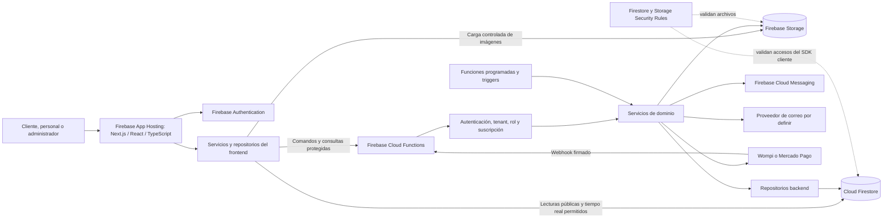

# Arquitectura general del sistema

**Producto:** plataforma SaaS multiempresa para restaurantes

**Estado:** arquitectura aprobada por el propietario el 5 de noviembre de 2026

**Base:** `docs/PROJECT_REQUIREMENTS.md` y prompt maestro
**Alcance:** arquitectura lógica y límites de responsabilidad; no define todavía el modelo de datos ni las rutas de colecciones de Firestore.

## 1. Objetivo y principios

La arquitectura debe permitir que varios restaurantes compartan la plataforma y mantengan sus datos aislados. El frontend no será autoridad para permisos, precios, suscripciones, inventario, pedidos ni pagos.

Principios de diseño:

1. Firebase será la infraestructura principal de identidad, persistencia, funciones, almacenamiento y notificaciones.
2. Next.js se ocupará de presentación, navegación y experiencia de usuario. Las reglas comerciales residirán en módulos de dominio ejecutados en backend.
3. El acceso a datos se organizará mediante servicios y repositorios; los componentes de interfaz no consultarán Firestore directamente.
4. Toda operación sensible comprobará identidad, tenant, rol y estado de suscripción en el servidor. Las reglas de Firestore y Storage ofrecerán una segunda barrera para operaciones del SDK cliente.
5. El servidor calculará precios, totales, permisos, vencimientos y transiciones de estado. Los valores enviados por el cliente se tratarán como datos no confiables.
6. Los módulos se separarán por dominio y mantendrán contratos explícitos entre sí.
7. Reintentos, eventos y callbacks externos deben ser idempotentes cuando puedan producir efectos comerciales.
8. Las decisiones de esquema, índices y rutas exactas se definirán en los Días 4 y 5.

## 2. Vista general



El acceso directo del SDK cliente que aparece en la vista se limita a repositorios autorizados para lecturas públicas explícitas, suscripciones de tiempo real aprobadas y carga de archivos. Las escrituras comerciales y las operaciones privilegiadas se ejecutan mediante Cloud Functions. No se permite que un componente React importe el SDK de Firestore o construya consultas.

## 3. Aplicaciones y responsabilidades

| Componente | Responsabilidades | Límites |
|---|---|---|
| Aplicación web Next.js en Firebase App Hosting | Páginas públicas, tienda de cada restaurante, paneles, formularios, navegación y renderizado responsive. Puede usar renderizado de servidor para páginas públicas. | No calcula valores autoritativos ni decide permisos. No contiene acceso a datos dentro de componentes visuales. |
| Servicios del frontend | Traducen acciones de pantalla a casos de uso y contratos de API; gestionan errores y estados de carga. | No conocen detalles de persistencia ni mantienen lógica duplicada de negocio. |
| Repositorios del frontend | Encapsulan llamadas a Cloud Functions, lecturas públicas permitidas, listeners aprobados y carga de archivos. | No se importan en componentes de presentación. El acceso de tiempo real debe estar cubierto por reglas de seguridad. |
| Firebase Authentication | Registro, inicio de sesión, recuperación y emisión de tokens de identidad. | La identidad por sí sola no concede acceso a un restaurante ni sustituye la autorización de backend. |
| Firebase Cloud Functions | API de negocio, validación de entrada, autorización, transacciones, tareas programadas, triggers y webhooks. | Los handlers de transporte delegan reglas de dominio; no confían en `tenantId`, rol, precio o estado enviados por el cliente. |
| Servicios de dominio | Casos de uso de tenants, catálogo, pedidos, suscripciones, pagos, domicilios, notificaciones, auditoría y reportes. | No dependen de Next.js ni de detalles de transporte; validan invariantes antes de persistir. |
| Repositorios backend | Lecturas y escrituras a Firestore y Storage mediante Firebase Admin SDK; encapsulan consultas y transacciones. | Cada operación recibe contexto autorizado y aplica límites de tenant. Admin SDK omite Security Rules, por lo que no reemplaza las verificaciones de servicio. |
| Cloud Firestore | Persistencia principal de datos de plataforma, restaurantes y operaciones. | La estructura, los índices y las reglas concretas se definen en las jornadas de modelo y colecciones. |
| Firebase Storage | Imágenes de productos y activos del restaurante. | Las rutas y políticas deben estar limitadas por tenant, tipo y tamaño de archivo. |
| Firebase Cloud Messaging | Notificaciones push a usuarios autorizados. | La falta de entrega de una notificación no cambia el estado del pedido o de la suscripción. |
| Pasarela de pago | Procesamiento externo que se configure, entre Wompi o Mercado Pago. | La confirmación se recibe mediante webhook verificado en backend; las credenciales privadas no llegan al navegador. |

## 4. Capas y organización modular propuesta

El repositorio está prácticamente vacío, por lo que la estructura de abajo es una propuesta; no se han creado aún esos directorios ni elegido herramientas adicionales.

```text
apps/web/
  src/app/                 rutas y layouts Next.js
  src/components/          componentes de presentación reutilizables
  src/features/            pantallas y componentes organizados por dominio
  src/services/             casos de uso y orquestación del frontend
  src/repositories/         adaptadores de API, lecturas permitidas y Storage
  src/lib/firebase/         inicialización separada para browser y server
  src/types/                tipos de interfaz y contratos

functions/src/
  index.ts                  exportación de endpoints, triggers y schedulers
  authorization/            permisos y resolución de membresías
  restaurants/              registro/tenant (domain, application, data)
  subscriptions/            prueba, planes, solicitudes y activación (futuro)
  catalog/                  categorías, productos, variantes e inventario (futuro)
  marketplace/              datos públicos y catálogos (futuro)
  orders/                   checkout, pedidos y estados (futuro)
  delivery/                 zonas, tarifas, asignaciones y entregas (futuro)
  payments/                 adaptadores y webhooks verificados (futuro)
  notifications/            notificaciones internas, push y correo (futuro)
  reporting/                métricas y reportes (futuro)
  audit/                    registro de acciones sensibles (futuro)
  shared/
    auth/                   extracción y validación de identidad
    validation/             validación de contratos de entrada
    errors/                 errores tipados y conversión a respuestas API
```

 En los módulos backend implementados se separa:

- **Entradas:** callable/HTTP handlers, triggers y funciones programadas; validan formato de entrada, identidad, App Check cuando aplique y permisos iniciales.
- **Casos de uso:** coordinan la operación y hacen cumplir las reglas del dominio.
- **Entidades y reglas:** definen estados válidos, invariantes y cálculos de negocio.
- **Repositorios:** encapsulan persistencia, consultas y transacciones.
- **Adaptadores externos:** encapsulan pagos, mapas y correo para que las reglas del negocio no dependan de un proveedor específico.

La elección de librerías de validación, estado, pruebas y generación de contratos queda para cuando exista código y se revise la necesidad. No se añade una dependencia en esta jornada.

## 5. Límites por dominio

| Dominio | Datos y responsabilidades lógicas |
|---|---|
| Identidad y tenants | Usuarios autenticados, pertenencia a restaurantes, roles, sedes y comprobación de alcance. |
| Restaurante y catálogo | Perfil, horarios, identidad visual, categorías, productos, variantes, adicionales e inventario. |
| Marketplace | Proyección explícitamente pública de restaurantes y productos publicados, búsqueda y filtros. |
| Pedidos | Validación de carrito, precios y disponibilidad; creación, estados, historial y eventos en tiempo real. |
| Domicilios | Cobertura, tarifas, asignación, seguimiento y entrega. |
| Suscripciones | Planes configurables, periodo de prueba, vencimiento, solicitudes, activación y restricciones comerciales. |
| Pagos | Intentos de pago, referencias, verificación de webhooks y efectos idempotentes. |
| Notificaciones | Registro interno, push, correo opcional, reintentos y prevención de duplicados. |
| Reportes y auditoría | Agregados basados en datos persistidos y eventos sensibles atribuibles a un actor. |

Los dominios no deben modificar directamente documentos de otro dominio. Las operaciones cruzadas se realizarán mediante casos de uso o contratos explícitos, con transacciones cuando el cambio deba ser atómico.

## 6. Flujos principales

### 6.1 Petición autenticada de restaurante

1. El usuario inicia sesión con Firebase Authentication.
2. El frontend adjunta el token de identidad vigente a una petición de Cloud Functions.
3. El handler valida la identidad, la forma de los datos y App Check cuando corresponda.
4. El servicio de autorización obtiene el tenant objetivo y comprueba la pertenencia, rol y estado de suscripción para esa acción.
5. El caso de uso valida las reglas de negocio y pasa el contexto autorizado al repositorio.
6. El repositorio realiza la operación de Firestore/Storage y devuelve un resultado acotado.
7. El frontend presenta el resultado sin asumir que la operación tuvo éxito hasta recibir confirmación del servidor.

No se aceptará como autoridad un `tenantId`, precio, rol, vencimiento o estado comercial enviado únicamente por el cliente.

### 6.2 Marketplace y actualizaciones en tiempo real

- Las páginas públicas consultarán solo una representación pública que excluya datos privados. Los campos publicables se definirán con el modelo de datos.
- Los paneles obtendrán datos privados mediante servicios y repositorios del frontend.
- Cuando una pantalla necesite actualizaciones en tiempo real, un repositorio podrá mantener una suscripción de Firestore a una ruta expresamente permitida. Security Rules validarán identidad, membresía y alcance del documento. Las reglas de estados y escrituras seguirán en backend.
- Las rutas y filtros exactos de cada listener, así como la autorización por tenant en Rules, se especificarán y probarán en las jornadas de colecciones y seguridad.

### 6.3 Creación de pedidos

1. El carrito se mantiene como estado de interacción en el cliente.
2. El cliente envía identificadores de productos, opciones, dirección y método elegido; no envía un total autoritativo.
3. La función de checkout vuelve a leer precios, disponibilidad, variantes, restaurante, tarifa y permisos desde la fuente autorizada.
4. El caso de uso valida que todos los artículos sean del mismo restaurante, calcula el total en servidor y, si el plan tiene inventario habilitado, reserva las cantidades en la sede que atenderá el pedido cuando lo registra como Recibido.
5. Una transacción o mecanismo equivalente persiste el pedido y la reserva sin duplicar la operación en reintentos. La reserva vence a los 15 minutos por defecto si no se confirma y envía a cocina; el propietario o un administrador autorizado puede configurar el plazo por sede.
6. Si vence una reserva activa, el backend cancela el pedido, libera el stock y notifica a cliente y restaurante. Sin el módulo de inventario, el pedido sigue el flujo normal y no se cancela por vencimiento de reserva.
7. Al confirmar y enviar el pedido a cocina, el backend convierte la cantidad reservada en cantidad descontada de existencias.
8. Si se cancela antes de enviarlo a cocina, se libera la reserva. Si se cancela durante la preparación, se restituye la cantidad descontada.
9. Después de salir de cocina no hay reposición automática. Un administrador puede registrar reposición manual si el producto sigue siendo seguro y vendible; en caso contrario registra merma. Un pago confirmado que llegue tras la cancelación no reactiva el pedido: se inicia un reembolso si el proveedor lo permite; de lo contrario, queda una tarea de revisión administrativa.
10. Las reservas y sus transiciones se registran por sede, se aplican de forma atómica e idempotente y no permiten descontar dos veces ni dejar existencias negativas. Variantes y adicionales tienen stock propio solo cuando se configuran como artículos inventariables.

### 6.4 Prueba gratuita y suscripciones

- El alta del restaurante genera el periodo de prueba con hora de servidor.
- Funciones programadas consultan vencimientos y fechas de recordatorio; cada envío/expiración tiene una clave o registro idempotente.
- El vencimiento cambia el acceso comercial según las reglas del servicio y mantiene acceso autorizado de lectura para consulta y contratación.
- La solicitud de plan guarda una instantánea del plan y precio seleccionados.
- Solo un flujo administrativo autorizado o un webhook de pago verificado activa la suscripción.

### 6.5 Pago y webhook

1. El backend crea la referencia de pago y la asocia a una entidad comercial.
2. El navegador redirige o recibe el estado del proveedor, pero esa respuesta no confirma el pago.
3. El webhook HTTP verifica firma/origen, referencia, monto, moneda, estado y duplicidad.
4. El servicio de pagos actualiza la transacción y dispara una única consecuencia de negocio.
5. Se registran eventos suficientes para auditoría, sin almacenar secretos ni datos sensibles innecesarios.

### 6.6 Carga de imágenes

El frontend solicitará la carga desde un servicio/repositorio y almacenará archivos en rutas asociadas al restaurante. Storage Rules limitarán quién puede cargar y modificar archivos; las funciones podrán validar metadatos o limpiar cargas huérfanas si el flujo lo requiere. Rutas, formatos y límites de tamaño se decidirán al implementar el catálogo.

## 7. Seguridad y aislamiento

1. **Identidad:** Firebase Authentication identifica al usuario; el backend verifica tokens con Firebase Admin SDK.
2. **Tenant:** el servidor deriva y valida la pertenencia actual del usuario al restaurante solicitado. No autoriza por un identificador de tenant enviado por el navegador.
3. **Rol:** las capacidades se validan contra membresía y reglas vigentes. Superadministración solo puede asignarse mediante un proceso de servidor autorizado.
4. **Admin SDK:** como Admin SDK omite Firestore y Storage Rules, cada endpoint aplica autorización antes de acceder al repositorio.
5. **Security Rules:** las reglas deniegan por defecto y permiten solo rutas, campos y operaciones necesarias para el SDK cliente. Lectura pública se limita a datos marcados para publicación.
6. **App Check:** reduce tráfico de clientes no reconocidos; complementa y no reemplaza Authentication, autorización ni Security Rules.
7. **Datos sensibles:** errores y registros no exponen tokens, secretos, firmas o datos personales innecesarios.
8. **Pagos:** secretos de proveedor se mantienen en backend; las transiciones financieras dependen de eventos verificados e idempotentes.
9. **Aislamiento:** pruebas con Emulator Suite cubrirán lecturas, escrituras, listeners, Storage y llamadas a funciones desde tenants y roles diferentes.

La ubicación y forma exacta de membresías, claims, datos públicos y documentos privados se decide en los Días 4 y 5 y debe permitir que las reglas apliquen el principio de mínimo privilegio.

## 8. Despliegue y entornos

- Se mantendrán entornos separados para desarrollo/emuladores, pruebas o staging y producción, cada uno con su configuración Firebase correspondiente.
- Authentication, Firestore, Functions y Storage se ejecutarán localmente mediante Firebase Emulator Suite para desarrollo y pruebas de seguridad.
- **Firebase App Hosting será el hosting de la aplicación web Next.js; Vercel queda excluido.** App Hosting tiene integración preconfigurada para Next.js y administra el build y el serving mediante Cloud Build, Cloud Run y Cloud CDN ([arquitectura y frameworks compatibles](https://firebase.google.com/docs/app-hosting/about-app-hosting)). El runtime de Next.js lo administra App Hosting; Cloud Functions seguirá siendo el backend de dominios y operaciones de negocio.
- App Hosting puede requerir el plan de pago por uso Blaze. Se confirmará facturación, alertas de presupuesto y región antes de habilitar el servicio ([guía oficial de inicio](https://firebase.google.com/docs/app-hosting/get-started)).
- La integración de App Hosting con GitHub podrá desplegar desde la rama elegida; también existe una ruta de despliegue mediante Firebase CLI. El mecanismo operativo se definirá al preparar los entornos.
- Cloud Functions desplegará los endpoints, tareas programadas y triggers. Ningún secreto de pago o correo se incluirá en el bundle del navegador.
- Los cambios de configuración y despliegue a producción tendrán revisión, observabilidad y un procedimiento de reversión; su guía concreta se preparará en la fase de producción.
- Las reglas, índices, funciones y configuración de entornos deben versionarse junto con el código una vez iniciada su implementación.

## 9. Decisiones operativas pendientes

La arquitectura general está aprobada. Estas decisiones operativas deben resolverse antes de implementar los flujos afectados:

Resuelto en el Día 12: la membresía vive en `restaurants/{restaurantId}/memberships/{uid}` y las autoridades de plataforma en `platformRoles/{uid}`. Functions deriva el UID del token y lee la asignación vigente; no se usan claims de rol como fuente autoritativa.

1. Región primaria de App Hosting y confirmación del plan de facturación y alertas de presupuesto.
2. Si los despliegues de App Hosting se conectarán a GitHub o se ejecutarán mediante Firebase CLI, y qué rama será la rama activa.
3. Qué lecturas privadas o de tiempo real usarán listeners del SDK cliente y cuáles pasarán siempre por Cloud Functions.
4. Identificación del cliente y alcance de acceso sin cuenta, según la decisión de compra como invitado.
5. Proveedor de correo y pasarela inicial entre Wompi y Mercado Pago.
6. Políticas de cobertura y cálculo de domicilio.
7. Métricas objetivo de disponibilidad, latencia y volumen para dimensionar índices, funciones y monitoreo.

## 10. Entregables y límites de esta jornada

El diseño de esta jornada establece los componentes, límites entre frontend/backend, dominios, flujos críticos, modelo de seguridad y decisiones pendientes. No crea código, recursos Firebase, colecciones, reglas ni credenciales. El esquema lógico se diseña en el Día 4 y la estructura de colecciones de Firestore en el Día 5.
